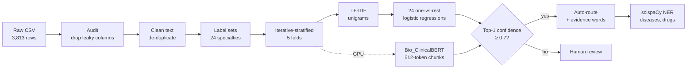

# Clinical Note Router

Routes a medical transcription to the clinical specialties that should receive it, reports how confident it is, sends uncertain notes to a human reviewer, and shows the words behind each decision.

MAAI 902 – Natural Language Processing & LLMs · Assessment Task 2 (NLP Solution Design) · University of Wollongong in Dubai

> Research prototype. Trained on public sample transcriptions. **Not for clinical use.**

## Results at a glance

5-fold iterative-stratified cross-validation on **1,751 unique notes, 24 specialties** (multi-label, leakage-free).

| Model | Macro-F1 | Micro-F1 | Top-1 routing accuracy |
|---|---|---|---|
| Prior (always "Surgery") | 0.030 ± 0.000 | 0.404 ± 0.001 | 0.569 ± 0.004 |
| TF-IDF + Naive Bayes | 0.545 ± 0.025 | 0.830 ± 0.013 | 0.870 ± 0.018 |
| TF-IDF + Linear SVM | 0.780 ± 0.035 | 0.886 ± 0.002 | 0.925 ± 0.009 |
| **TF-IDF + Logistic Regression (tuned)** | **0.809 ± 0.033** | **0.892 ± 0.006** | **0.934 ± 0.011** |
| Bio_ClinicalBERT (chunked), fold 0 only | 0.544 | 0.741 | 0.831 |
| TF-IDF + LR, fold 0 only (same fold) | 0.805 | 0.888 | 0.931 |

* Top-1 calibration error (ECE) **0.039**.
* With a 0.7 review threshold, **87.5%** of notes are routed automatically at **96.7%** top-1 accuracy. The remaining 12.5% go to a person.

## Three findings about the data that shape the design

1. **Label leakage.** The `keywords` column begins with the specialty name in 100% of rows. It is never used as an input.
2. **Duplicates.** The 3,813 rows hold only 1,821 unique transcriptions. 1,650 of them are filed under 2+ specialties (e.g. a knee arthroscopy is both *Orthopedic* and *Surgery*), so the task is **multi-label**, and splits must be made on unique notes.
3. **Mixed taxonomy.** Seven labels are document types (*Discharge Summary*, *SOAP / Chart / Progress Notes*, …), not specialties. Removing them and the 8 specialties with fewer than 15 notes raises macro-F1 from 0.70 to 0.81.

`src/leakage_experiments.py` shows how these choices move the headline score. With the same model, accuracy ranges from **0.10** (random single-label split) to **0.81** (oversampling before the split).

## Pipeline



## Repository layout

```
clinical-note-routing/
├── data/                      Healthcare_Documentation_Database.csv (course dataset)
├── src/
│   ├── config.py              paths, label taxonomy, seed
│   ├── data_prep.py           audit, de-duplication, multi-label sets, iterative stratification
│   ├── eda.py                 figures 1-3
│   ├── train_baseline.py      tuning + 4 models, CV, calibration, review trade-off, final model
│   ├── leakage_experiments.py ablation of evaluation protocols (E0-E6)
│   ├── train_transformer.py   Bio_ClinicalBERT / Clinical-Longformer fine-tuning (GPU)
│   ├── ner.py                 scispaCy disease & drug extraction
│   ├── predict.py             route(text) -> specialties, confidence, decision, evidence
│   ├── export_demo.py         exports the model to JSON for the browser demo
│   └── app.py                 Gradio web UI
├── notebooks/
│   ├── 01_data_understanding_and_preprocessing.ipynb   Colab-ready, self-contained: EDA, cleaning, pre-processing
│   └── clinical_note_routing.ipynb                     modelling, evaluation, explainability, ablation
├── demo/                      index.html + router.js + model.json (runs fully in the browser)
├── results/                   metrics (JSON/CSV) and figures
└── models/                    tfidf_lr.joblib (created by train_baseline.py)
```

## How to run

**Google Colab (two notebooks, in this order):**

1. `notebooks/01_data_understanding_and_preprocessing.ipynb`: *File → Upload notebook*, *Runtime → Run all*, upload `Healthcare_Documentation_Database.csv` when asked. Standalone: data understanding (A1–A9), cleaning (B1–B6), pre-processing (C1–C7).
2. `notebooks/clinical_note_routing.ipynb`: upload the notebook, run the first cell and upload `clinical-note-routing.zip` (this whole repository) when asked, then *Run all*. Modelling, evaluation, explainability and ablation. For the transformer cell, first switch to a GPU runtime (*Runtime → Change runtime type → T4 GPU*).

**Full pipeline (scripts):**

```bash
pip install -r requirements.txt          # core: pandas, numpy, scikit-learn, matplotlib
python src/data_prep.py                  # ~5 s   -> data/notes_multilabel.pkl, results/data_stats.json
python src/eda.py                        # figures 1-3
python src/train_baseline.py             # ~3 min -> results/*.json, figures 4-6, models/tfidf_lr.joblib
python src/leakage_experiments.py        # ~4 min -> results/leakage_experiments.json
python src/export_demo.py                # demo/model.json
node demo/check_parity.js                # checks browser maths == scikit-learn (optional)
```

**Web UI**

```bash
python src/app.py                        # Gradio at http://127.0.0.1:7860
cd demo && python -m http.server 8000    # browser demo at http://127.0.0.1:8000
```

**Transformer and NER (Google Colab, GPU runtime)**

```bash
pip install transformers accelerate scispacy
python src/train_transformer.py --model emilyalsentzer/Bio_ClinicalBERT --folds 0 1 2 3 4
python src/train_transformer.py --model yikuan8/Clinical-Longformer --max-len 4096 --batch 2 --accum 8
python src/ner.py
```

The transformer uses the same folds, threshold rule and metrics as the classical models, so its numbers can be added straight to the table above.

## Reproducibility

* Random seed 42 everywhere (`config.SEED`); folds are deterministic.
* Thresholds are tuned on an inner 15% validation split of each training fold, never on the test fold.
* Tested with Python 3.13, scikit-learn 1.9, pandas 2.x. The transformer and NER scripts need internet access to Hugging Face / scispaCy. They are provided for a GPU run and were not executed in the original build environment.

## Ethics and limitations

* **Privacy:** the browser demo runs locally, so no note leaves the device. A real deployment would need de-identification, on-premise hosting and HIPAA/GDPR-compliant access control.
* **Bias:** specialties defined by patient group or broad scope score lowest (Pediatrics F1 0.51, Hematology–Oncology 0.57, Dermatology 0.63, General Medicine 0.65). The review threshold sends low-confidence notes to people.
* **Scope:** MTSamples are sample transcriptions, not real EHR notes, and are English only. External validation on real hospital data is required before any use.

## Data

MTSamples medical transcriptions (mtsamples.com), as provided in the course dataset `Healthcare_Documentation_Database.csv`.
